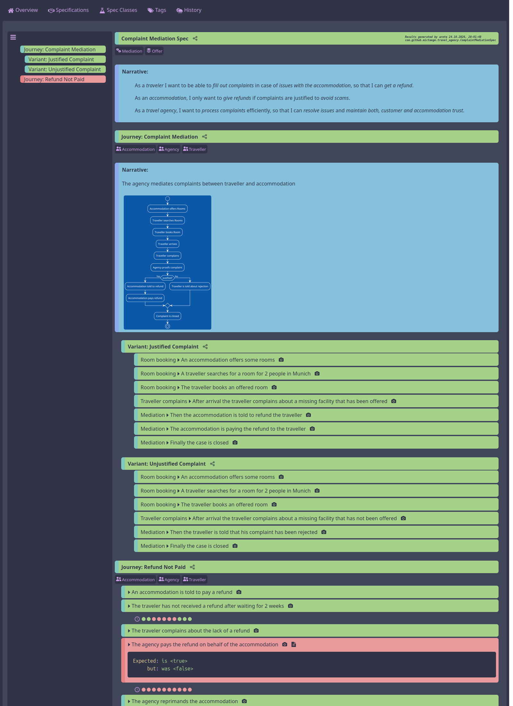

# Arete-Gradle-Plugin

[](https://plugins.gradle.org/plugin/io.github.mictaege.arete)
[](https://search.maven.org/search?q=g:%22io.github.mictaege%22%20AND%20a:%22arete-gradle%22)
[](https://central.sonatype.com/artifact/org.junit.jupiter/junit-jupiter/5.10.2)
[](http://www.apache.org/licenses/LICENSE-2.0.html)

Gradle reporting plugin for the [Arete](https://github.com/mictaege/arete) JUnit6 testing framework.



## Usage

Add the `arete-gradle` plugin to your `build.gradle` file.

```Groovy
plugins {
    id 'java'
    id 'io.github.mictaege.arete' version '20xx.x.x'
}
```

## Reports

The reports generated for the `arete` specifications will be written to the `<your_project>/build/reports/arete/<task>/index.html` folder.
This is a parallel structure to the gradle test reporting structure `<your_project>/build/reports/test/<task>/index.html`.

### Excluding disabled test in the report

Per default disabled tests are included in the report. This is useful to indicate that a feature or
scenario is not yet implemented or does it need further discussion and this fact should obviously reflected in the report.

```Java
@Scenario
@Disabled("Needs further discussion with the product owner")
class ShowOrderHistory {
    ...
}
```

In other situations a test is disabled because it's not applicable for the current environment or because of a certain
version of the product. In this case it's better to exclude the test from the report of this environment or version. To
exlude a disabled test from the report add the `@HiddenIfDisabled` annotation to the feature, scenario or method.

```Java
@Scenario
@EnabledIf(com.github.mictaege.travel_agency.Feature.MONITARIZATION)
@HiddenIfDisabled
class ShowAdvertisement {
    ...
}
```

## Screenshot-Taking

```Java
@Spec class WebshopSpec {

    private WebDriver webDriver;
    
    @RegisterExtension
    public ScreenshotExtension screenshots 
            = new ScreenshotExtension(new MySeleniumScreenshotTaker(webDriver));
    
    //...

}
```

```Java
public class MySeleniumScreenshotTaker implements ScreenshotTaker {

    private WebDriver webDriver;
    
    public MySeleniumScreenshotTaker(WebDriver webDriver) {
        this.webDriver = webDriver;
    }
    
    @Override
    public Set<TestResult> takeWhen() {
        return Stream.of(SUCCESS, FAILURE).collect(toSet());
    }

    @Override
    public byte[] getImageBytes() {
        //Read PNG image bytes from web driver
    }

}
```

Screenshots are published as JUnit file attachments. When the Arete Gradle plugin is applied, it
copies them into the Arete report and history, then removes the attachment files and empty per-test
directories; screenshots are therefore retained only in the report and history. Without the plugin,
JUnit keeps the attachments under its configured output directory until the build is cleaned.

## Reporting Stdout and Stderr

If tests fail for unclear reasons or from time to time, especially on a CI server, it might be useful to see the stdout and stderr of the failing test.

Reporting stdout and stderr can be enabled in your `build.gradle.kts` file.

```Kotlin
arete {
    captureStdout = true
    captureStderr = true
    captureMaxBuffer = 1048576
}
```

### Specification history

Arete keeps the latest 10 test-task runs per specification by default. Each leaf step (e.g. a
`@Given`/`@When`/`@Then` step, an `@ItShould` or a single example) in a specification report shows its
previous states and timestamps; containers such as specifications or scenarios have no history of their
own. Failed or aborted runs also retain the stack trace,
captured stdout/stderr, and screenshot when available. History is stored outside `build/` in
`<rootProject>/.gradle/arete-history`, so the Gradle `clean` task does not remove it. The `cleanAreteHistory`
task removes the history for the current project.

```Kotlin
arete {
    historyEnabled = true
    historyMaxAge = 10
    // Optional: historyDir = file("/var/lib/arete-history/my-job")
}
```

The store directory can also be set with `-Parete.historyDir=/path/to/history` or the
`ARETE_HISTORY_DIR` environment variable. For ephemeral CI workers or jobs that wipe the workspace,
point it at persistent storage and restore/save that directory between builds. Each test task and
project uses a separate subdirectory. Stdout and stderr history is only available when their
respective capture options are enabled.

## Colorschemes

The colorscheme of the reports can be changed by setting the `arete.colorscheme` property in your `build.gradle.kts` file.

Either by using a predefined colorscheme

```Kotlin
arete {
    colorScheme = CatppuccinLatteColors()
}
```

overriding a predefined colorscheme

```Kotlin
arete {
    colorScheme = object : CatppuccinFrappeColors() {
        override var arete_plantuml_theme = "amiga"
    }
}
```

or by providing an own custom colorscheme.

```Kotlin
arete {
    colorScheme = object : AreteColorScheme {
        override val arete_color_background = "#000000"
        override val arete_color_card = "#111111"
        override val arete_color_foreground = "#ffffff"
        override val arete_color_ignored = "gray"
        override val arete_color_ignored_emph = "darkgray"
        override val arete_color_successful = "green"
        override val arete_color_successful_emph = "darkgreen"
        override val arete_color_aborted = "orange"
        override val arete_color_aborted_emph = "darkorange"
        override val arete_color_failed = "red"
        override val arete_color_failed_emph = "darkred"
        override val arete_color_neutral = "blue"
        override val arete_color_neutral_emph = "darkblue"
        override val arete_plantuml_theme = "amiga"
    }
}
```
Currently predefined colorschemes are:
- `AreteClassicColors`
- `CatppuccinMochaColors`
- `CatppuccinMacchiatoColors`
- `CatppuccinFrappeColors`
- `CatppuccinLatteColors`
- `DraculaColors`
- `AlucardColors`
